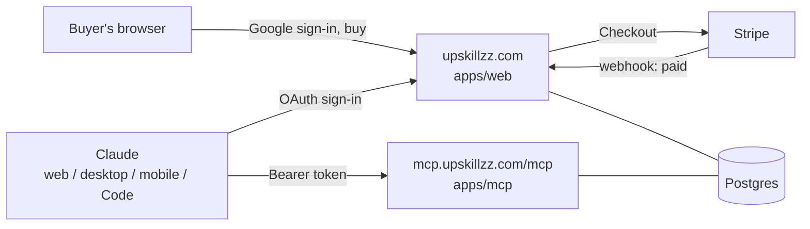

# Upskillzz

Upskillzz is a store for Claude skills. Buyers sign in with Google, buy a skill or a pack once, and connect Claude to the Upskillzz MCP server. Every skill they own then shows up in Claude as a tool. The skill's instructions stay on our server and are sent only to signed-in owners, at the moment Claude needs them. Claude does the actual work on the buyer's own Claude subscription.

> **Status:** planning skeleton. There is no application code yet. Several Claude Code agents build it in parallel from the docs in this repo. Start with [docs/agents/README.md](docs/agents/README.md).

> **Keep this repository private.** Paid skill content lives in `content/skills/*/SKILL.md`.

## How it works



1. The buyer signs in with Google on upskillzz.com and buys a skill or a pack (Stripe Checkout, one-time payment, EUR, VAT included).
2. Stripe tells the site the payment succeeded. The site records an entitlement: this user owns these skills.
3. The buyer adds `https://mcp.upskillzz.com/mcp` as a connector in Claude (or runs one command in Claude Code) and signs in with the same Google account. The tutorial on the site walks them through it with screenshots.
4. The MCP server lists one tool per skill the buyer owns. When a task matches, Claude calls the tool and gets the skill's instructions back. Any script logic runs on our server as an extra tool.
5. New skills are folders in `content/`. Merging to `main` validates them, syncs them to the database and Stripe, and redeploys.

More detail: [docs/ARCHITECTURE.md](docs/ARCHITECTURE.md). Why it is built this way: [docs/DECISIONS.md](docs/DECISIONS.md).

## Repository map

| Path | What lives there | Owner |
|---|---|---|
| `apps/web` | Website: storefront, library, tutorial, sign-in, OAuth server for Claude, Stripe routes | W5, with sub-paths owned by W1, W4, W6 |
| `apps/mcp` | The MCP server Claude connects to | W2 |
| `packages/auth` | Better Auth setup: Google sign-in and the OAuth provider Claude uses | W1 |
| `packages/db` | Drizzle schema, migrations, database client | W0, then orchestrator (auth tables: W1) |
| `packages/shared` | Types, Zod schemas and constants used across packages | W0, then orchestrator |
| `packages/content` | Loads and validates `content/`, builds the public catalog, syncs to DB and Stripe | W3 |
| `packages/entitlements` | Who owns which skill | W4 |
| `packages/payments` | Stripe Checkout, webhooks, product sync | W4 |
| `content/` | The skills and packs you sell (Markdown and YAML) | You; W3 owns the format and samples |
| `infra/` | Dockerfiles, Fly.io configs, local Postgres | W7 (local Postgres: W0) |
| `e2e/` | End-to-end tests | W8 |
| `docs/` | Architecture, decisions, contracts, agent briefs, status board | Orchestrator |

The full ownership map is in [docs/WORKSTREAMS.md](docs/WORKSTREAMS.md).

## Stack

- TypeScript monorepo: pnpm workspaces, Turborepo, Node 24 LTS
- Website: Next.js (App Router), Tailwind CSS, shadcn/ui, MDX for the tutorial
- Auth: Better Auth with Google sign-in, plus its MCP plugin so the site is the OAuth server Claude signs in through
- MCP server: official MCP TypeScript SDK (v2) on Hono, Streamable HTTP, protocol versions 2026-07-28 and 2025-11-25
- Database: Postgres (Neon) with Drizzle ORM
- Payments: Stripe Checkout (one-time) and Stripe Tax
- Hosting: Fly.io in Frankfurt for web and MCP, Neon Postgres in Frankfurt, Cloudflare for DNS and caching. Roughly $6 to $10 a month to start.
- Quality: Vitest, Playwright, Biome

## Before the agents start (your setup)

Agents can build and test almost everything locally without real accounts, thanks to a dev-only test login and Stripe test mode. You'll need these before testing with real Claude apps:

1. Create a **private** GitHub repo and push this skeleton.
2. Install Node 24 LTS, pnpm (`corepack enable`), Docker, the Stripe CLI and Claude Code.
3. Google Cloud: create an OAuth client (type "Web application"). Redirect URIs are listed in [docs/LOCAL_DEV.md](docs/LOCAL_DEV.md).
4. Stripe: create an account and copy the test-mode keys.
5. For staging and launch: a Neon project (Frankfurt), a Fly.io account, the domain and Cloudflare. See [docs/LAUNCH_CHECKLIST.md](docs/LAUNCH_CHECKLIST.md), which also covers the tax and legal points to check with an accountant.

## Running the parallel agents

Short version (full guide with copy-paste prompts: [docs/agents/README.md](docs/agents/README.md)):

```bash
git init -b main && git add -A && git commit -m "chore: planning skeleton"
scripts/setup-worktrees.sh            # one worktree + branch + .env.local per workstream

# Phase 0, one terminal:
cd ../upskillzz-wt/w0-foundation && claude
# Phase 1, five terminals (W1-W5) plus one orchestrator terminal in this folder.
```

## Commands (available after W0 finishes)

| Command | What it does |
|---|---|
| `pnpm install` | Install everything |
| `pnpm db:up` / `pnpm db:down` | Start or stop local Postgres in Docker (one database per worktree) |
| `pnpm db:push` | Apply the current schema to your local database (dev only) |
| `pnpm db:generate` | Create a migration from schema changes (orchestrator only, on main) |
| `pnpm db:migrate` | Apply migrations |
| `pnpm db:reset` | Recreate your local database, push the schema, sync content |
| `pnpm dev` | Run web and MCP server with hot reload on your worktree's ports |
| `pnpm build` / `pnpm test` / `pnpm typecheck` / `pnpm lint` / `pnpm format` | The usual |
| `pnpm content:validate` | Check every skill and pack in `content/` |
| `pnpm content:build` | Build the public catalog the website uses |
| `pnpm content:sync -- --dry-run` | Show what would change in the database and Stripe |
| `pnpm e2e` | End-to-end tests |

## Docs index

- [docs/ARCHITECTURE.md](docs/ARCHITECTURE.md): components, request flows, security invariants
- [docs/DECISIONS.md](docs/DECISIONS.md): every major choice, alternatives, sources
- [docs/WORKSTREAMS.md](docs/WORKSTREAMS.md): workstreams, path ownership, phases, ports
- [docs/contracts/](docs/contracts/): the shared contracts agents build against
- [docs/agents/](docs/agents/): agent briefs, the status board, how to run everything
- [docs/LOCAL_DEV.md](docs/LOCAL_DEV.md): local setup, Google and Stripe in dev, testing with Claude
- [docs/LAUNCH_CHECKLIST.md](docs/LAUNCH_CHECKLIST.md): what has to be true before real customers pay
- [content/README.md](content/README.md): how to write and publish a skill
