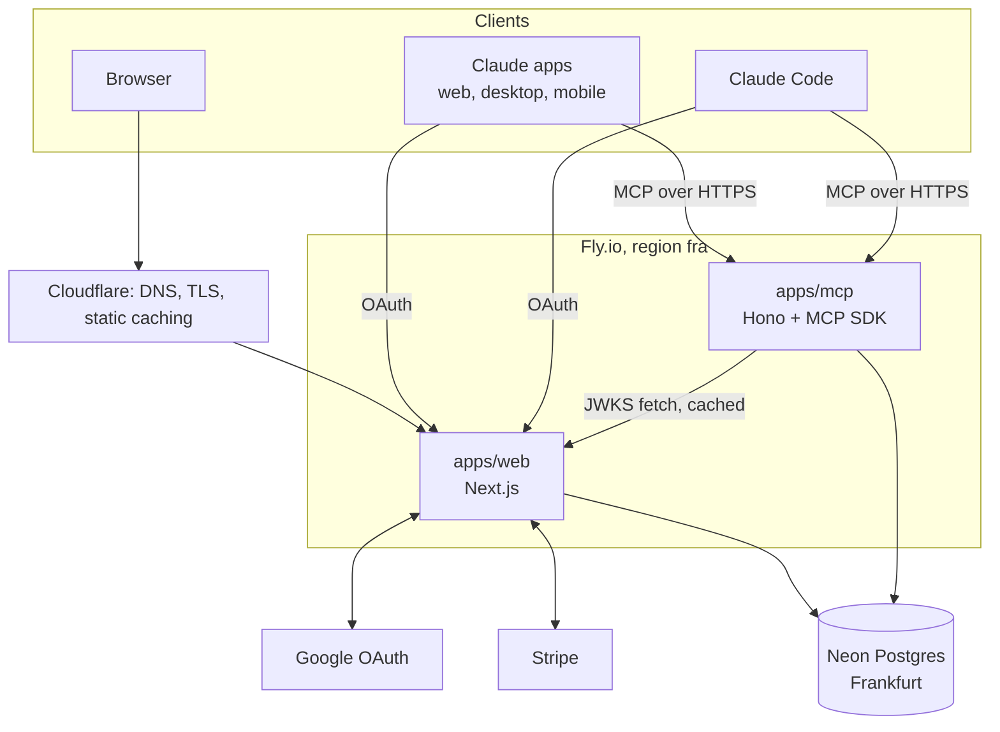
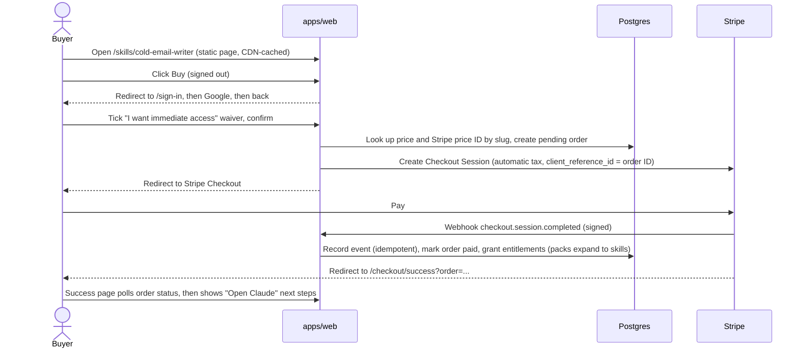
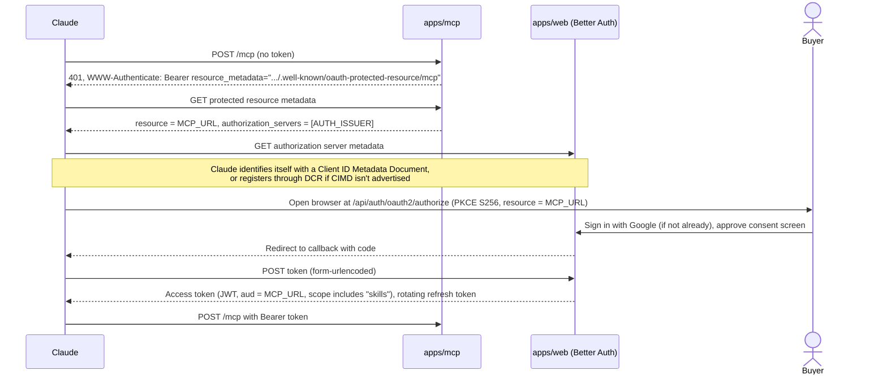
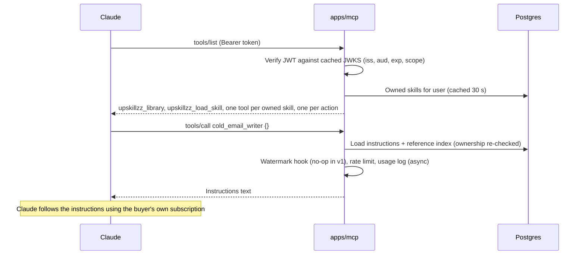
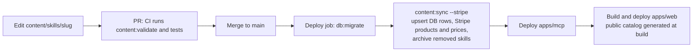

# Architecture

This document describes how Upskillzz fits together. Exact shapes (tables, function signatures, tool schemas, routes) live in `docs/contracts/`. When this document and a contract disagree, the contract wins.

## Components

| Component | Responsibilities | Does not |
|---|---|---|
| `apps/web` | Storefront and catalog pages, library, tutorial, Google sign-in, OAuth authorization server for MCP clients (authorize, token, registration, consent, JWKS, discovery), Stripe Checkout and webhooks, free claims | Serve paid skill content |
| `apps/mcp` | MCP endpoint, protected-resource metadata, token verification, per-user tool list, skill delivery, server-side actions, rate limiting, usage logging | Issue tokens, take payments |
| `packages/content` | Read and validate `content/`, build the public catalog, sync content to the database and (through `packages/payments`) to Stripe, generate the action registry | Talk to users |
| `packages/entitlements` | Answer "does user X own skill Y", grant and revoke ownership | Talk to Stripe |
| `packages/payments` | Create checkout sessions, verify and process webhooks, sync products and prices to Stripe | Decide ownership rules (it calls `packages/entitlements`) |
| `packages/auth` | Better Auth instance and plugins, session helpers, the token verifier `apps/mcp` uses | Know about skills |
| `packages/db` | Schema, migrations, client | Contain business logic |
| `packages/shared` | Zod schemas, types, constants shared across packages | Have dependencies on other workspace packages |

Dependency direction: `apps/*` → `packages/{auth,content,entitlements,payments}` → `packages/db` → `packages/shared`. Packages never import from apps. `packages/payments` may import `packages/entitlements`; not the other way round.

## Public URLs

| URL | Served by |
|---|---|
| `https://upskillzz.com` (`APP_URL`) | `apps/web` |
| `https://upskillzz.com/api/auth/*` | Better Auth inside `apps/web` (sign-in, OAuth endpoints, JWKS) |
| `https://mcp.upskillzz.com/mcp` (`MCP_URL`) | `apps/mcp`, the URL buyers paste into Claude |
| `https://mcp.upskillzz.com/.well-known/oauth-protected-resource[/mcp]` | `apps/mcp` |

The domain is a placeholder until bought. Everything reads it from env (`docs/contracts/env.md`).

## Flow 1: browse and buy

Free skills skip Stripe: a signed-in user clicks "Get it free" and `POST /api/claim` grants the entitlement.

Refunds: Stripe sends `charge.refunded`. A full refund marks the order refunded and revokes the entitlements that order created. The skill's tool disappears from that user's next tool list.

## Flow 2: connect Claude (one-time per buyer)

Callbacks: `https://claude.ai/api/mcp/auth_callback` for the Claude apps; a loopback `http://localhost:<any port>/callback` or `http://127.0.0.1:<any port>/callback` for Claude Code.

## Flow 3: using a skill

Because the protocol is stateless, `apps/mcp` builds a fresh MCP server object per request from the verified user's entitlements. There is no session store.

Tool list freshness: claude.ai on the web and Claude Code fetch the tool list per conversation or session. Claude's desktop and mobile apps have been reported to cache it from when the connector was added, until the user picks "Refresh tools list" in connector settings. So `upskillzz_load_skill` is always present: it can load any owned skill by slug even when Claude's tool list is stale. The tutorial and the post-purchase page tell buyers what to do.

## Flow 4: publishing content

Sync runs before the web deploy so a newly listed skill is always purchasable. Removing a skill folder archives it: it disappears from the store, and owners keep using it.

## Data ownership

| Tables | Written by | Read by |
|---|---|---|
| Better Auth tables (`user`, `session`, `account`, `verification`, `jwks`, OAuth client/token/consent tables) | Better Auth in `apps/web` | `apps/web` |
| `skill`, `skill_reference`, `skill_action`, `pack`, `pack_item` | `packages/content` sync only | everyone |
| `orders`, `order_item`, `stripe_event` | `packages/payments` | `apps/web` |
| `entitlement` | `packages/entitlements` only | `apps/web`, `apps/mcp` |
| `mcp_usage` | `apps/mcp` | reporting later |

## Performance notes

- Catalog, skill and pack pages are statically generated at build from the public catalog and cached by Cloudflare. Browsing never touches the database.
- Both Fly machines are always on (no cold starts). Only the database scales to zero on Neon's free plan; the first query after 5 idle minutes adds a cold start of typically under a second. Upgrade path: a paid Neon plan with scale-to-zero disabled.
- `apps/mcp` keeps the JWKS and per-user owned-skill lists in memory with short TTLs, so a tool call is usually one indexed query.

## Security invariants

These are repeated in the root `CLAUDE.md`, and every agent must keep them:

1. Paid text is served only by `apps/mcp`, only to the verified owner.
2. Public outputs (catalog JSON, website build) contain only public fields. A test scans them for paid text.
3. Prices are read from the database at checkout.
4. Entitlements come only from verified, idempotent webhook processing or free claims.
5. Published skills are archived, never deleted.
6. Dev login cannot run in production.
7. Tokens are verified for signature, issuer, audience, expiry and scope on every MCP request.
8. Secrets, tokens, full emails and paid text never appear in logs.

Not protected by design: a buyer can copy text Claude shows them. Per-buyer watermarking (deferred, hook already in the delivery path) and license terms handle that. See `docs/DECISIONS.md` D10.
